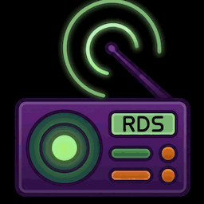

# Dynamic_RDS - FM Transmitter Plugin for Falcon Player<br clear="right">

Dynamic_RDS turns a small FM transmitter board into a light show radio station. It controls a **QN8066** or **Si4713** transmitter from Falcon Player (FPP) over I<sup>2</sup>C, broadcasts your show audio, and sends RDS (Radio Data System) text so car radios show the song title, artist, and your own messages - just like a commercial station.

> [!NOTE]
> Dynamic_RDS supports the **QN8066** and **Si4713** FM transmitter chips

* Fully customizable RDS text using static text and the song's title, artist, album, genre, track number, track length, and playlist position
* Live view of what's being broadcast on the plugin's config page
* Turn the transmitter on with FPPD, with a playlist, or manually - including from an FPP master to its remotes
* Song titles from the [FPP After Hours Music plugin](https://github.com/jcrossbdn/fpp-after-hours) between shows
* Optional status publishing to MQTT

> [!IMPORTANT]
> FM broadcasting is regulated in most countries. Keep the frequency, power, and antenna within what your local rules allow (in the US, see FCC Part 15).

## Contents
- [Requirements](#requirements)
- [Quick start](#quick-start)
- [Choosing a transmitter](#choosing-a-transmitter)
- [Si4713 setup](#si4713-setup)
- [QN8066 setup](#qn8066-setup)
- [RDS text](#rds-text)
- [When the transmitter is on](#when-the-transmitter-is-on)
- [Manual transmitter control](#manual-transmitter-control)
- [Integrations](#integrations)
- [Plugin settings reference](#plugin-settings-reference)
- [Troubleshooting](#troubleshooting)
- [Report an issue](#report-an-issue)

## Requirements
* **FPP 10.0 or newer** for the current version. Older FPP versions (6.0-9.x) automatically get the last plugin version that supported them.
* **Raspberry Pi** or **BeagleBone Black (BBB)**. The Si4713 needs a Raspberry Pi, since its reset line uses a Pi GPIO.
* A **QN8066** or **Si4713** transmitter board, wired to the I<sup>2</sup>C bus
* An **antenna** suited to the board (required for the QN8066)
* An **audio path** from FPP into the transmitter's audio input. The Pi's 3.5mm output works if your Pi has one. A USB sound card or DAC is needed if the Pi has no analog audio (such as a Pi Zero) or when hardware PWM is used with the QN8066

## Quick start
1. **Install** - In FPP, go to **Content Setup -> Plugin Manager**, find **Dynamic RDS**, and install it. FPP will ask to restart when it's done.
2. **Wire it up** - With everything powered off, connect the transmitter to the I<sup>2</sup>C pins (and reset pin for the Si4713). See [Si4713 setup](#si4713-setup) or [QN8066 setup](#qn8066-setup). Connect the antenna and the audio.
3. **Open the config page** - **Status/Control -> Dynamic RDS**. The plugin scans the I<sup>2</sup>C bus and selects the transmitter it finds (QN8066 at 0x21, Si4713 at 0x63). Settings that don't apply to your transmitter are hidden.
4. **Pick a frequency** - Find an empty spot on the FM dial where you are, and set the **Frequency**. Set **Preemphasis** for your region (75 &mu;s in the US and South Korea, 50 &mu;s most other places).
5. **Restart FPPD** - With the default **Start with: FPPD Start**, the transmitter turns on when FPPD starts.
6. **Play something** - Tune a radio to your frequency. You should hear the audio and see the RDS text change with each song. The status section at the top of the config page shows what is being broadcast.

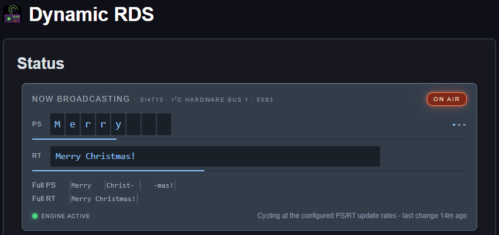

The status section shows:
* **Now Broadcasting** - the detected transmitter, I<sup>2</sup>C bus, and address, with **ON AIR** lit while the transmitter is on
* **PS** and **RT** - the text as a radio would show it, stepping through each screen at the configured update rates. This is simulated in the browser to show the timing - it isn't read back from the transmitter
* **Full PS** and **Full RT** - every screen in the current message
* **Engine status** - whether the plugin's engine is running, and how long ago the broadcast text last changed

> [!TIP]
> Settings marked with a lightning bolt icon on the config page take effect immediately. Others need an FPPD restart.

## Choosing a transmitter

| | Si4713 | QN8066 |
| --- | --- | --- |
| Board | Small breakout board (originally Adafruit, now mostly clones) | "5W/7W PLL FM Stereo Transmitter" board with a separate amplifier |
| Power | Powered from the Pi | Chip powered from the Pi, amplifier needs 12V |
| Output power | Low - good for a yard or driveway | Higher, with the amplifier controlled by PWM |
| Antenna | Wire or small antenna on the board's antenna pad | Real antenna required on the BNC connector |
| Platforms | Raspberry Pi | Raspberry Pi and BBB |
| RDS timing | Text is loaded into the chip's buffers, which cycle on their own | Each RDS group is sent by the plugin, using the PS/RT update rates |
| Extras | Antenna tuning capacitor (auto by default) | Audio gain, mono mode, soft clipping, PWM amplifier control |

## Si4713 setup
The Si4713 breakout board was originally from [Adafruit](https://www.adafruit.com/product/1958), which is now out of stock. Clones are on [AliExpress](https://www.aliexpress.us/w/wholesale-Si4713-transmitter.html) and elsewhere. Pin labels can differ slightly between clones.

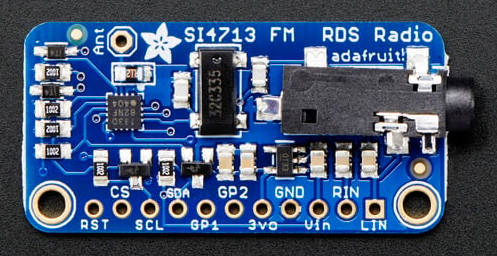

### Wiring to a Raspberry Pi
| Si4713 board | Raspberry Pi |
| --- | --- |
| VIN | Pin 1 (3.3V) |
| GND | Pin 6 (GND) |
| SDA | Pin 3 (GPIO 2 / SDA) |
| SCL | Pin 5 (GPIO 3 / SCL) |
| RST | Pin 7 (GPIO 4) by default |

The reset pin can be changed under **Transmitter Type and Settings -> Reset Pin / GPIO**. The Si4713 only runs while its reset line is held high, and the plugin keeps it high while the transmitter is on. When the transmitter is turned off, the chip is held in reset and won't show up on the I<sup>2</sup>C bus until it's turned on again.

Feed audio into the board's audio input (3.5mm jack or the LIN/RIN pins, depending on the board).

### Antenna
For bench testing, a short wire on the antenna pad is enough. For better range, use a quarter-wave wire for your frequency - about 75 cm (30 in) at 100 MHz. The **Antenna Tuning Capacitor** setting defaults to 0, which lets the chip tune itself. When the transmitter starts playing media, the plugin log shows what the chip reports:

```
Status - Freq: 100.1 MHz - Power: 115 - Antenna Cap: 32 - Noise: 0
```

**Power** is the chip's reported output level, and **Antenna Cap** is the tuning value it chose (0.25 pF steps).

### Si4713 notes
* The RDS text is loaded into the chip's on-board buffers, which the chip cycles through on its own. This keeps system load low, but the timing of each message can't be controlled directly, and total text length is limited by how many buffers the chip has.
* **Chip Power** ranges from 88-120. Accuracy above 115 dB&mu;V isn't guaranteed.

## QN8066 setup
> [!IMPORTANT]
> There are similar looking boards that use other chips, so double check for the QN8066. For a detailed look at identifying QN8066 boards, check out [Spectraman's video](https://www.youtube.com/watch?v=i8re0nc_FdY&t=1017s).

[AliExpress search for the QN8066 FM Transmitter](https://www.aliexpress.us/w/wholesale-5W-PLL-FM-Stereo-Transmitter-Max-power-7W.html)

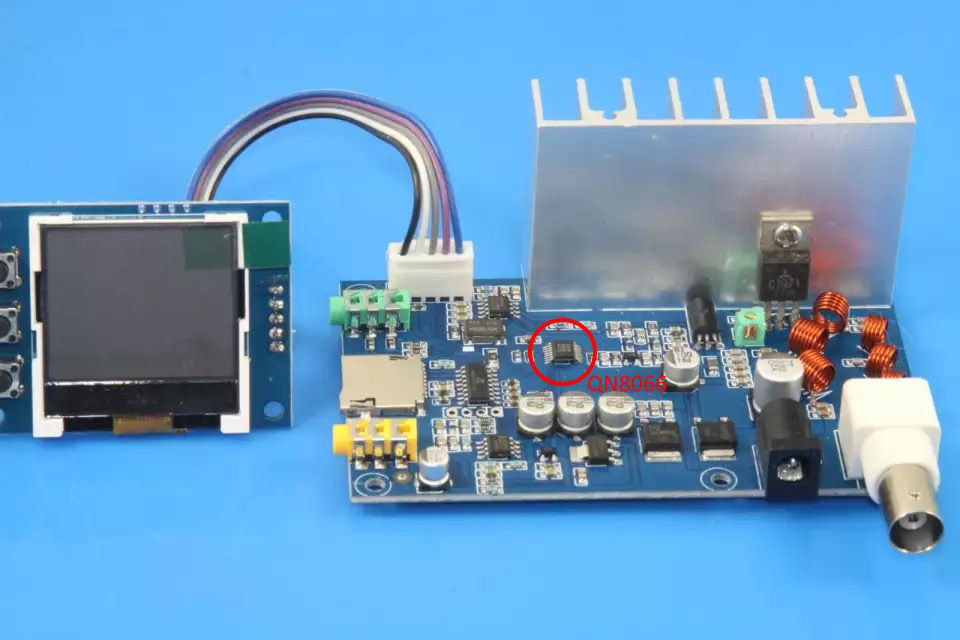
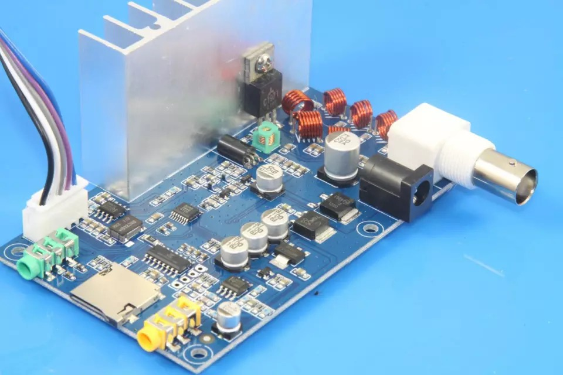
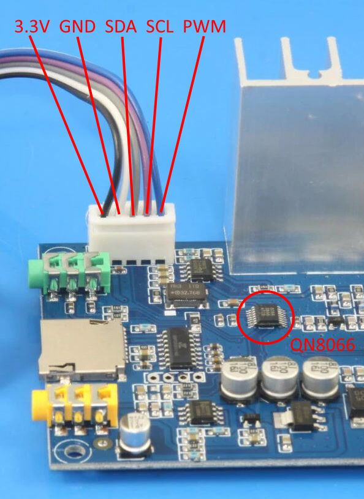

The plugin replaces the board's screen. It connects to the screen's 5-pin connector for 3.3V, GND, SDA, SCL, and PWM. The board's amplifier still needs its own 12V supply.

### Antenna
> [!CAUTION]
> Never power the QN8066 board's amplifier without an antenna connected.

* Small bench testing option - https://www.amazon.com/gp/product/B07K7DBVX9
* 1/4 wave ground plane antenna calculator - https://m0ukd.com/calculators/quarter-wave-ground-plane-antenna-calculator/
* Show ready 1/4 wave option - https://www.amazon.com/Transmitter-Professional-87-108mhz-0-5w-100w-Waterproof/dp/B09NDPY4JG
* Inexpensive 1/4 wave option - https://www.aliexpress.us/item/2251832695723994.html
* BNC to BNC cable - https://www.amazon.com/gp/product/B0BVVVRYZL/

### Cables and connectors
> [!CAUTION]
> Do not run the PWM wire alongside the I<sup>2</sup>C wires. During testing, this caused I<sup>2</sup>C failures as soon as PWM was enabled.

* The transmitter board uses a 5-pin JST-XH connector, 2.54mm
* The Raspberry Pi uses female Dupont connectors - a 2 x 6 block connector is recommended
* The BeagleBone Black (BBB) uses male Dupont connectors

If you are comfortable crimping your own connectors:
* JST-XH connectors - https://www.amazon.com/dp/B015Y6JOUG
* Dupont connectors - https://www.amazon.com/dp/B0774NMT1S
* Single kit with both JST-XH and Dupont connectors - https://www.amazon.com/dp/B09Q5MPM7H/
* JST-XH kit with crimping tool - https://www.amazon.com/gp/product/B094XSF2GK

Pre-crimped wires are also an option:
* JST-XH pre-crimped wires - https://www.amazon.com/dp/B0BW9TJN21
* Dupont pre-crimped wires - https://www.amazon.com/dp/B07GD1W1VL

#### Cable for a Raspberry Pi
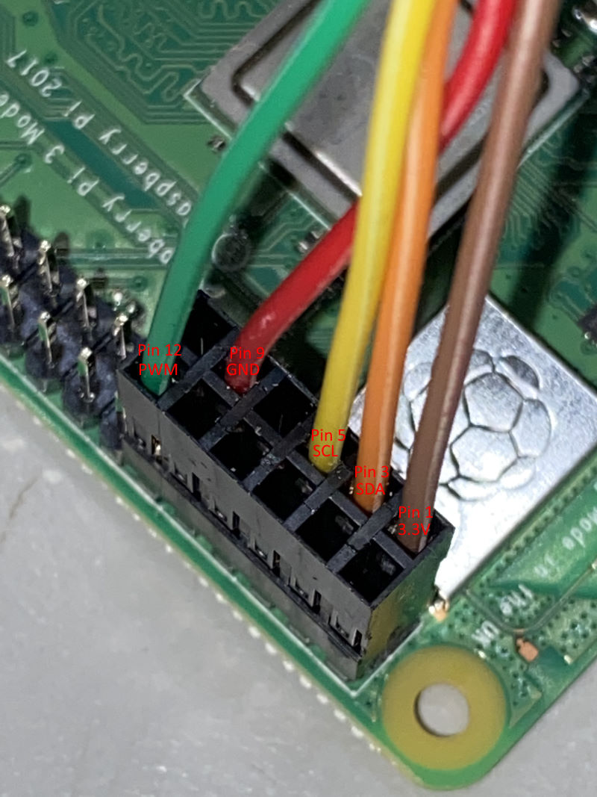
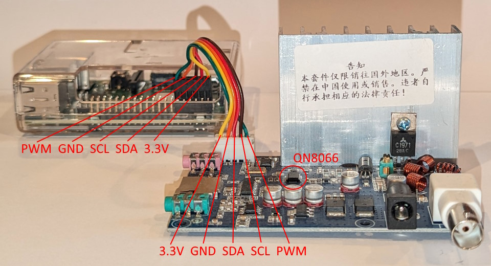
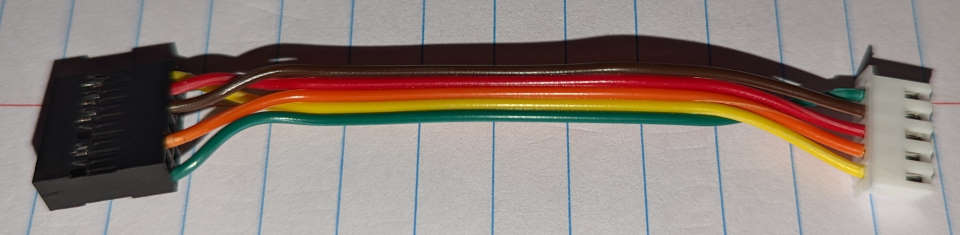

The green PWM wire runs next to the yellow 3.3V and orange GND wires until right before the end, to avoid interference. Keeping the cable as short as possible also helps.

#### Cable for a BeagleBone Black (BBB)
(Cable details for the BBB are still in progress)

### Shielding and RF interference
An FM transmitter right next to a Pi/BBB can cause interference, which usually shows up as I<sup>2</sup>C errors that get worse as power increases. Moving the antenna away from the Pi/BBB and transmitter board helps. A much more robust setup is to put the Pi/BBB and transmitter board in a grounded metal case with the antenna outside, as @chrkov did here:

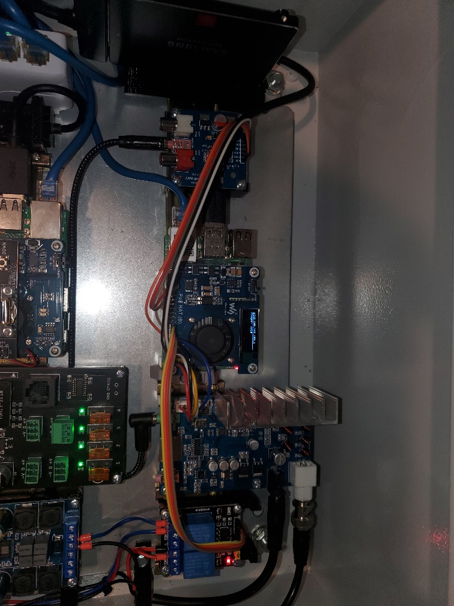
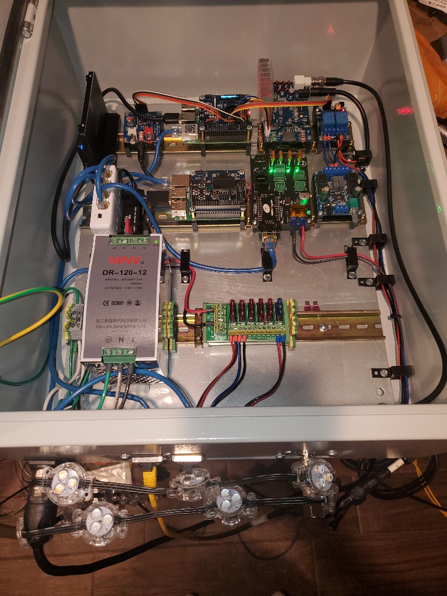

### Amplifier power with PWM
The QN8066 board's amplifier output is controlled with a PWM signal, set by **Amp Power** (0-100) once **Enable PWM** is on.

On the Raspberry Pi, hardware PWM shares hardware with the built-in analog audio, so enabling it turns off the on-board audio and a USB sound card or DAC is required. Enabling PWM automatically updates `/boot/firmware/config.txt`:
1. Comments out all `dtparam=audio=on` lines with a `#`
2. Adds `dtoverlay=pwm,pin=18,func=2` by default

The PWM pin can be changed under **Advanced Options**, which is also where software PWM can be selected on most other pins (more CPU use and less accurate). On the BBB, the PWM pin is also selected under Advanced Options.

> [!TIP]
> Don't forget to change the Audio Output Device in the FPP Settings to use the USB sound card or DAC.

## RDS text
RDS has two text fields that radios display:
* **PS (Program Service)** - 8 characters at a time. This is what most radios show, often as the "station name." Longer text is broken into 8-character screens that change every **PS Update Rate** seconds.
* **RT (RadioText)** - longer messages, up to 64 characters at a time (32 recommended). Not every radio shows RT, and some only show it on a button press.

The **PS Style Text** and **RT Style Text** settings control what is sent. They mix static text with values from the currently playing media:

| Code | Value |
| --- | --- |
| `{T}` | Title (falls back to the media or sequence file name if the file has no title tag) |
| `{A}` | Artist |
| `{B}` | Album |
| `{G}` | Genre |
| `{N}` | Track Number |
| `{L}` | Track Length, as 0:00 |
| `{C}` | Item count in the Main Playlist section |
| `{P}` | Item position in the Main Playlist section |

Formatting rules:
* Any static text can be mixed in freely
* `|` (pipe) splits between RDS screens, acting like a line break
* `[ ]` creates a subgroup - if **any** substitution inside is empty, the whole subgroup is dropped. This is how you avoid stray text like "by" with no artist
* Use `\` in front of `| { } [ ]` to display those characters literally
* The end of the style text acts as a line break
* `{P}` is left empty when both it and `{C}` are 1, to prevent "1 of 1" messages
* Accented and other non-ASCII characters are converted to their closest plain letters

The defaults show how this works:
* PS: `{T}|{A}[|{P} of {C}]|Merry|Christ-|   -mas!` shows the title, the artist, "3 of 12" (only when in a playlist), then "Merry Christmas!" across three screens
* RT: `{T}[ by {A}][|Track {P} of {C}] Merry Christmas!`

Changes to the style text and update rates take effect immediately.

### Changing the text on a schedule
During install, an example script is copied to FPP's `media/scripts` folder as `Dynamic_RDS_config.sh`. It changes the PS and/or RT style text without restarting FPP - for example, to show different messages during the show and after it. Edit the script, then run it from the scheduler or a playlist with the **Run Script** command. Keep the single quotes around the style text so bash doesn't interpret it. The original is in [scripts/src_Dynamic_RDS_config.sh](scripts/src_Dynamic_RDS_config.sh).

## When the transmitter is on
The **Plugin Activation** settings control when the transmitter turns on and off:

| Setting | Default | Notes |
| --- | --- | --- |
| Start with | FPPD Start | **FPPD Start** turns the transmitter on when FPPD starts. **Playlist Start** turns it on when a playlist starts. With either, a playlist start also turns the transmitter back on if it is off (e.g. after a Playlist Stop or `--stop`). **Never** leaves it off until started manually - see [Manual transmitter control](#manual-transmitter-control). On start the transmitter is reset, settings initialized, audio broadcast begins, and static RDS messages are sent. A transmitter that is already on is left as is |
| Stop with | Never | Or Playlist Stop. On stop the transmitter is turned off and listeners hear static |

> [!NOTE]
> **On an FPP Remote**, Playlist Start and Playlist Stop don't behave the same as on a player. Remotes have no playlists, so FPP only sends a single start the first time media plays and never sends a stop - Playlist Stop won't turn the transmitter off on a remote. Use FPPD Start, or Never with [manual control](#manual-transmitter-control) from the master.

## Manual transmitter control
To control the transmitter yourself - for example, from an FPP master's schedule - set **Start with** and **Stop with** to **Never**, then use the FPP Command or the command line. Manual control doesn't change playlist state, so After Hours song titles keep updating whenever the transmitter is on and no playlist is playing. Repeated start or stop commands are harmless.

### FPP Command
The plugin registers an FPP Command, **Dynamic_RDS Transmitter State**, with an Action of **Start** or **Stop**. It can be used anywhere FPP Commands are: command presets, playlist Command entries, the scheduler, GPIO inputs, MQTT, or the API at `/api/command/Dynamic_RDS%20Transmitter%20State/Start`.

**For a master and remotes**, enable MultiSync on the command in the command editor and pick the remote hosts. The master sends the command over MultiSync and each remote runs it locally - no scripts or SSH needed. Each remote needs the plugin installed.

### Command line
```sh
sudo python3 /home/fpp/media/plugins/Dynamic_RDS/callbacks.py --start
sudo python3 /home/fpp/media/plugins/Dynamic_RDS/callbacks.py --stop
```

* `--start` starts the plugin's engine if needed, then turns the transmitter on
* `--stop` turns the transmitter off and leaves the engine running. If the engine isn't running, it does nothing
* `--exit` shuts the engine down

> [!NOTE]
> Both the FPP Command and the command line send the request without waiting for a result - FPP reports the command as complete, and the exit status is 0, once it has been sent. Check the status section of the config page or the plugin log to confirm the transmitter state.

## Integrations
### After Hours Music
With the [FPP After Hours Music plugin](https://github.com/jcrossbdn/fpp-after-hours) installed, Dynamic_RDS can show the title of the internet stream's current song as `{T}` when no playlist is playing. Enable it in the **MPC / After Hours Music** section of the config page (the section only appears when the After Hours plugin is installed).


On FPP remotes, After Hours titles take over once the stream reports a song, replacing the last show song's details.

### MQTT
Dynamic_RDS can publish what it is broadcasting to MQTT. First configure MQTT under **FPP Settings -> MQTT**, then install `python3-paho-mqtt` with the button on the config page and enable MQTT in the plugin.

Topics are under `falcon/player/<hostname>/plugin/Dynamic_RDS/` (with FPP's MQTT prefix in front, if one is set). All are retained.

| Topic | Payload |
| --- | --- |
| `ready` | `1` when connected, `0` on a clean shutdown, `-1` if the engine drops off unexpectedly |
| `config` | JSON of the plugin settings, published on startup and when settings change |
| `status` | JSON of what is being broadcast, published each time the RDS data is updated |

The `status` JSON includes the full PS and RT text (`PStext`, `RTtext`), the screens radios show (`PSfragments`, `RTfragments` - empty for the Si4713, which buffers on the chip), the update rates (`PSdelay`, `RTdelay`), the current substitution values (`RDSValues`), whether RDS is enabled (`RDSEnabled`), whether the transmitter is on (`transmitterActive`), the transmitter type (`transmitterType`), and the engine's process id (`pid`).

## Plugin settings reference
All settings are on the config page at **Status/Control -> Dynamic RDS**.

### RDS Settings
| Setting | Default | Notes |
| --- | --- | --- |
| Enable RDS | On | Turns off all RDS transmission when unchecked |
| PI Code | `819b` | Program Identification code. Some older receivers translate this to a callsign - `819b` is WRAP, `5F64` is WEBS |
| Program Type | 2 - Information / Current Affairs | Standard PTY list; assignments differ between North America and Europe |
| PS Style Text | `{T}\|{A}[\|{P} of {C}]\|Merry\|Christ-\|   -mas!` | See [RDS text](#rds-text) |
| PS Update Rate | 4 sec | Time between 8-character screens (3-60). It takes ~1 second to send 8 characters, and some radios only display text after receiving it twice |
| RT Style Text | `{T}[ by {A}][\|Track {P} of {C}] Merry Christmas!` | See [RDS text](#rds-text) |
| RT Update Size | 32 chars | 8-64. RT supports up to 64, but not all radios display that much at once. 32 is recommended |
| RT Update Rate | 7 sec | Time between RT messages (3-60). Sending a full 64 characters takes ~4 seconds |

### Transmitter Type and Settings
| Setting | Default | Notes |
| --- | --- | --- |
| Transmitter Type | Auto-selected | Set from I<sup>2</sup>C detection (QN8066 at 0x21, Si4713 at 0x63). Can be changed manually |
| Frequency | 100.10 | 60.00-108.00 for the QN8066, 76.00-108.00 for the Si4713 |
| Preemphasis | 75 &mu;s | 75 &mu;s for the US and South Korea, 50 &mu;s for most of the rest of the world |
| Antenna Tuning Capacitor *(Si4713)* | 0 | 0 lets the chip tune itself; manual range is 1-191 |
| Reset Pin / GPIO *(Si4713)* | Pin 7 / GPIO 4 | The Si4713 needs its reset pin held high to operate |

### Audio Settings *(QN8066)*
| Setting | Default | Notes |
| --- | --- | --- |
| Gain Adjustment | 0 | Range -15 to +20. Too high or too low causes distortion, random dropouts, or silence |
| Transmit in Mono | Off | Drops the 19 kHz stereo pilot and L-R subcarrier. About 20 dB better signal-to-noise at the edge of coverage and full deviation for the audio. Recommended when the show audio is mono |
| Enable Soft Clipping | Off | |
| Enable AGC | Off | Not recommended |

### Power Settings
| Setting | Default | Notes |
| --- | --- | --- |
| Chip Power *(QN8066)* | 122 | Range 92-122 |
| Chip Power *(Si4713)* | 115 | Range 88-120. Accuracy above 115 dB&mu;V is not guaranteed |
| Enable PWM *(QN8066)* | Off | Hardware PWM on Pin 12 / GPIO 18 by default, used to control the amplifier. On the Pi, this disables the on-board audio, so an external sound card is needed |
| Amp Power *(QN8066)* | 0 | Range 0-100, controlled with PWM |

### Plugin Activation
See [When the transmitter is on](#when-the-transmitter-is-on).

### MPC / After Hours Music and MQTT
See [Integrations](#integrations).

### Log Levels and Logs
The callback and engine log levels are set separately (Errors Only / Warn / Info / Debug, plus Excessive for the engine). Both write to `plugin-Dynamic_RDS.log`, which can be viewed from the config page with **View Recent** or **View All**.

### Advanced Options
Software I<sup>2</sup>C mode for the Raspberry Pi, and PWM pin selection for the Pi and BBB. Most setups won't need these.

## Troubleshooting
Start with the status section at the top of the config page. It shows errors such as a missing dependency (with a button to reinstall it), no I<sup>2</sup>C bus found, no transmitter detected, or the engine not running. Then check the plugin log with the log levels set to Debug.

### Transmitter not detected
* With everything powered off, check every wire: 3.3V, GND, SDA, SCL (and RST for the Si4713). No really, go double check! It can happen to anyone :)
* Check each wire's continuity to make sure there isn't a break
* Check the I<sup>2</sup>C bus from SSH: `i2cdetect -y 1` on a Pi, or `i2cdetect -r -y 2` on a BBB. Look for 0x21 (QN8066) or 0x63 (Si4713)
* **Si4713:** the chip only answers while its reset pin is high. If it doesn't show up, check the RST wire and the **Reset Pin / GPIO** setting, then restart FPPD
* **QN8066:** do the first test with the 12V amplifier power and PWM wire disconnected - the chip is powered from the Pi

### QN8066 not transmitting
* Verify the transmitter works on its own: connect the original screen, the antenna, 12V power, and audio to the input near the screen connector, then check for it on a radio. If there is nothing, the board may be bad
* Remove power and disconnect the screen before connecting it to the Pi/BBB

### Weak signal or radios not showing RDS
Radios need a stronger signal to decode RDS than to play audio, so missing RDS is often a signal problem.
* Check the antenna. A missing or wrong-length antenna gives a weak signal
* Check **Chip Power** (and **Amp Power** on the QN8066)
* **Si4713:** look for the `Status - Freq ... - Power ... - Antenna Cap ...` line in the log after media starts playing. If **Power** doesn't match the Chip Power setting, the chip didn't accept it
* Try a clean, separate power supply. Noisy supplies, such as some PoE splitters, can affect the transmitter
* Make sure **Enable RDS** is on, and try a different radio - not all radios show RT

### I<sup>2</sup>C errors in the log
* If there are too many errors, I<sup>2</sup>C fails and the engine exits
  * Reduce the Amp Power and Chip Power - RF interference can affect I<sup>2</sup>C
  * Move the antenna further from the transmitter board and Pi/BBB
  * Make sure the PWM wire does NOT run alongside the I<sup>2</sup>C wires
  * Try Software I<sup>2</sup>C (Advanced Options, Pi only)
  * Put the Pi/BBB and transmitter in a grounded metal box with the antenna outside
  * Check the connections and wire continuity

### "Could not load plugin Dynamic_RDS" after a reboot
On slower boards like the Pi Zero W, FPP can give up on the plugin while it is still starting during boot ([#88](https://github.com/ShadowLight8/Dynamic_RDS/issues/88)). Restarting FPPD once the Pi has finished booting loads it normally.

### After Hours titles not showing
* Make sure **Enable MPC support** is on in the MPC / After Hours Music section
* Titles only show while the transmitter is on and no playlist is playing
* The title comes from the stream's metadata - some streams don't send song titles

## Report an issue
Set both log levels to Debug, reproduce the problem, then use **Download log and config zip** on the config page and attach the file to a [new issue](https://github.com/ShadowLight8/Dynamic_RDS/issues). The zip contains the log and rotated copies, the `plugin.Dynamic_RDS` config, the last RDS output, the plugin version, and your Pi/BBB boot config. Suggestions are welcome too.
